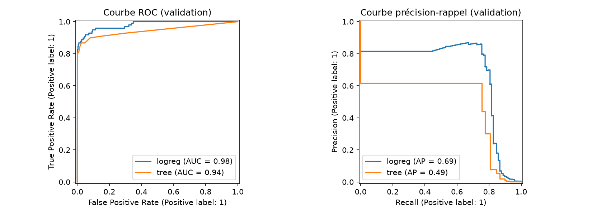

# Évaluation du modèle de détection de fraude

## 1. Protocole

- Données : Credit Card Fraud Detection (284 807 transactions, 492 fraudes, soit 0,17 %).
- Séparation stratifiée 60 % entraînement / 20 % validation / 20 % test, `random_state=42`.
- Pipeline : `StandardScaler` ajusté sur l'entraînement uniquement, puis modèle.
- Modèles comparés : régression logistique et arbre de décision (profondeur max 5), tous deux avec `class_weight="balanced"` pour compenser la rareté des fraudes.
- Seuil de décision choisi sur la **validation** : celui qui maximise la précision sous la contrainte rappel >= 0,80.
- Le jeu de test n'est utilisé qu'une seule fois, pour le modèle retenu, après tous les choix.

## 2. Comparaison sur la validation (98 fraudes, 56 863 transactions normales)

| Modèle | Seuil | Précision | Rappel | F1 | ROC-AUC | PR-AUC | FPR | FNR | Accuracy |
|---|---|---|---|---|---|---|---|---|---|
| Régression logistique | 0,5 | 0,0650 | 0,8776 | 0,1210 | 0,9806 | 0,6857 | 0,0218 | 0,1224 | 0,9781 |
| Régression logistique | 0,9991 (choisi) | 0,6991 | 0,8061 | 0,7488 | 0,9806 | 0,6857 | 0,0006 | 0,1939 | 0,9991 |
| Arbre de décision | 0,5 | 0,0557 | 0,8673 | 0,1047 | 0,9445 | 0,4891 | 0,0253 | 0,1327 | 0,9745 |
| Arbre de décision | 0,9582 (choisi) | 0,3015 | 0,8061 | 0,4389 | 0,9445 | 0,4891 | 0,0032 | 0,1939 | 0,9965 |

La ROC-AUC et la PR-AUC ne dépendent pas du seuil, d'où les valeurs identiques pour un même modèle.

## 3. Matrices de confusion (validation)

Lignes : classe réelle. Colonnes : classe prédite.

**Régression logistique, seuil 0,5**

| | Prédit normale | Prédit fraude |
|---|---|---|
| Réel normale | TN = 55 626 | FP = 1 237 |
| Réel fraude | FN = 12 | TP = 86 |

**Régression logistique, seuil 0,9991**

| | Prédit normale | Prédit fraude |
|---|---|---|
| Réel normale | TN = 56 829 | FP = 34 |
| Réel fraude | FN = 19 | TP = 79 |

**Arbre de décision, seuil 0,9582**

| | Prédit normale | Prédit fraude |
|---|---|---|
| Réel normale | TN = 56 680 | FP = 183 |
| Réel fraude | FN = 19 | TP = 79 |

## 4. Courbes ROC et précision-rappel

## 5. Évaluation finale sur le test (régression logistique, seuil 0,9991)

| | Prédit normale | Prédit fraude |
|---|---|---|
| Réel normale | TN = 56 832 | FP = 31 |
| Réel fraude | FN = 17 | TP = 82 |

| Métrique | Validation | Test |
|---|---|---|
| Précision | 0,6991 | 0,7257 |
| Rappel | 0,8061 | 0,8283 |
| F1 | 0,7488 | 0,7736 |
| ROC-AUC | 0,9806 | 0,9662 |
| PR-AUC | 0,6857 | 0,7575 |
| FPR | 0,0006 | 0,0005 |
| FNR | 0,1939 | 0,1717 |

Les résultats sur le test sont cohérents avec la validation : pas de signe de surapprentissage ni de fuite de données. Les petits écarts s'expliquent par le faible nombre de fraudes (environ 100 par jeu).

## 6. Interprétation

**Pourquoi l'accuracy est trompeuse.** Un modèle qui ne prédirait jamais de fraude aurait une accuracy d'environ 99,83 %, tout en détectant 0 fraude (rappel nul). Avec le seuil 0,5, notre modèle a 97,8 % d'accuracy mais seulement 6,5 % de précision : l'accuracy masque le problème. C'est pourquoi on s'appuie sur le rappel, la précision, la PR-AUC et la matrice de confusion.

**Faux négatifs (fraudes non détectées).** Sur le test, 17 fraudes sur 99 ne sont pas détectées (FNR = 17,2 %). Ce sont des pertes financières directes pour la banque et ses clients.

**Faux positifs (fausses alertes).** Sur le test, 31 transactions légitimes sur 56 863 sont bloquées (FPR = 0,05 %). Ce sont des paiements refusés et des réclamations. Avec le seuil par défaut, il y en aurait eu plus de 1 200 : le réglage du seuil réduit les fausses alertes d'un facteur 35 environ, au prix de quelques fraudes manquées en plus.

**Compromis lié au seuil.** Passer de 0,5 à 0,9991 fait baisser les faux positifs de 1 237 à 34 et augmente les faux négatifs de 12 à 19. Le choix dépend du coût relatif des deux erreurs : ici, la contrainte rappel >= 0,80 protège contre les fraudes manquées, et la précision est maximisée sous cette contrainte.

**Comparaison des modèles.** À rappel identique (79 fraudes détectées), la régression logistique produit 34 fausses alertes contre 183 pour l'arbre, et affiche une meilleure ROC-AUC et PR-AUC. Elle est retenue. L'arbre n'a pas été optimisé (profondeur fixée à 5) : la comparaison est donc à relativiser.

## 7. Vérification des critères d'acceptation

| Critère | Seuil | Résultat | Statut |
|---|---|---|---|
| Rappel | >= 0,80 | 0,8283 (test) | Respecté |
| Taux de faux positifs | <= 1 % | 0,05 % (test) | Respecté |
| PR-AUC | supérieure à un modèle naïf (environ 0,0017) | 0,7575 (test) | Respecté |
| Latence P95 | < 50 ms | À mesurer (Activité 8) | En attente |
| Non-régression | Tolérance à définir | À mesurer (Activité 6) | En attente |
| Workflow CI vert | Oui | À mettre en place (Activité 9) | En attente |

## 8. Limites

- Le test ne contient que 99 fraudes : le rappel de 0,83 a une marge d'incertitude d'environ 0,07 (intervalle de confiance à 95 % : 0,75 à 0,90). Le critère rappel >= 0,80 est respecté mais pas démontré avec certitude.
- Le seuil retenu (0,9991) est très proche de 1, en raison de `class_weight="balanced"` : il est sensible à toute modification du modèle ou des données.
- Une seule séparation des données a été utilisée : une validation croisée donnerait une estimation plus stable.
- Le jeu de données date de 2013 et provient de transactions européennes : ces résultats ne prouvent pas la performance sur les transactions bancaires actuelles.
- Les variables V1 à V28 sont anonymisées : les erreurs ne peuvent pas être expliquées en termes métier.
